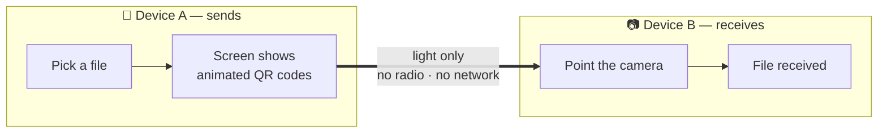

# DeadDrop

**Pass files from one device to another with no internet, no cables, no Bluetooth. Just the screen and the camera.**

> ⚠️ **Development status — read this before relying on DeadDrop for your safety**
>
> DeadDrop is in **active development** (MVP target: February 2027). **What works today:** air-gapped file transfer via animated QR codes, end-to-end encrypted (X25519 + XSalsa20-Poly1305, Ed25519-signed session) between two devices; and a **vault** with a passphrase-protected decoy environment and optional self-destruct.
>
> The vault, decoy environment and self-destruct are implemented, but with real limits you should read before relying on them:
>
> - **Self-destruct is off by default** and must be turned on deliberately in Settings.
> - **The decoy holds whatever you put in it** — the app does not generate fake content for you, so an unprepared decoy is not convincing.
> - **Device testing is partial**: exercised by hand on Android and Linux, plus the automated test suite. **Not yet tested on iOS or macOS.**
> - Self-destruct **discards keys, not files**, and can be **triggered deliberately** by an attacker who just keeps guessing wrong.
>
> Full details, including passphrase-strength and offline-attack limits, are in [docs/security.md](docs/security.md); planned work is tracked in [Issues](../../issues).

---

## Why does DeadDrop exist?

Imagine you have documents on your laptop that you need to hand over **in person** to someone standing one metre away. Today your options are bad:

- **Sending them over the internet** (email, WhatsApp, cloud): even encrypted, you leave a permanent trail on third-party servers: who sends, who receives, when.
- **Bluetooth or AirDrop**: they emit detectable signals and get logged by the system.
- **A USB drive**: the first thing seized at a checkpoint, and a classic malware vector.

DeadDrop solves this: one device's screen shows animated QR codes, the other device's camera reads them, and the file crosses **end-to-end protected without a single byte touching any network**. You can turn on airplane mode in front of anyone and the transfer works just the same.

**Who is it for?** For the journalist handing a leak to her newsroom. For the activist passing evidence to a lawyer. For anyone who wants to hand over personal documents without them passing through third-party servers. Privacy is a right (Articles 12, 19 and 20 of the Universal Declaration of Human Rights), not a technical privilege.

---

## How it works in 30 seconds

1. **You pick the file** on the sending device.
2. **Animated QR codes appear** on its screen (the file travels inside them, protected so only the recipient can open it).
3. **The other device points its camera** and receives the file. Done.

No accounts, no configuration, no servers, no logs.

---

## Installation

Download the installer for your system from the [Releases](../../releases) page (or build from source — see [CONTRIBUTING.md](CONTRIBUTING.md)):

### Windows
1. Download `deaddrop-windows-x64.zip`.
2. Unzip it anywhere and run `dead_drop.exe` (if SmartScreen warns you, click "More info" → "Run anyway").

### macOS
1. Download `deaddrop-macos-arm64.tar.gz` (Apple Silicon).
2. Unpack it and move DeadDrop to Applications.
3. The first time, open it with right-click → "Open" (Gatekeeper requires this for non-notarized apps).

### Linux
1. Download `deaddrop-linux-x64.tar.gz`.
2. Unpack it: `tar xzf deaddrop-linux-x64.tar.gz`.
3. Run `./dead_drop`.

### Android
1. Download `deaddrop-android.apk`.
2. Open it on the phone. Android will ask you to allow installing from this
   source the first time — there is no app store listing, by design.
3. Open DeadDrop from the home screen.

> **Verification:** each release publishes the SHA-256 checksums of the binaries and instructions to reproduce the build from source. See [docs/security.md](docs/security.md).

---

## First use in 2 minutes

1. **Open DeadDrop on both devices.** No account needed.
2. On the **sending** device: tap **"Send a file"** and pick the file.
3. On the **receiving** device: tap **"Receive a file"** and point the camera at the other screen.
4. You'll see a progress bar on both. When finished, the receiver taps **"Save"** and chooses where.

That's it. The [full user guide](docs/user-guide.md) walks through every step, what to do if the camera struggles to read, and an up-to-date list of [what works today and what does not](docs/user-guide.md#what-works-today-and-what-does-not).

---

## Quick questions

**Do I need internet?** No. Never. Not to install the app (if you copy it via USB), not to use it, not to activate it.

**What if someone forces me to unlock it?** The vault has a **decoy passphrase** for exactly this situation: a second, independently-encrypted environment you set up beforehand with your own files, indistinguishable from the real one in behaviour and unlock timing. It only helps if you configure it in advance and keep its content credible — the app does not invent decoy content for you. Files outside the vault have no such protection. Current protections and honest limits (including what has and has not been tested on real devices): [docs/security.md](docs/security.md).

**Is it legal?** Yes. DeadDrop is free software (MIT licence), auditable by anyone, and does not hide its own existence. It protects the same right as a sealed letter: the privacy of correspondence. Full analysis in the [FAQ](docs/faq.md#is-it-legal).

More answers in [docs/faq.md](docs/faq.md).

---

## Project status

DeadDrop is in active development for the **#cryptograFREE** challenge (RootedCON + Criptored). This repository has been public since day one and will remain so forever.

- ✅ Documentation and value proposition
- ✅ E2E-encrypted air-gapped transfer prototype (v0.1)
- ✅ Vault: passphrase-protected storage, decoy environment, optional self-destruct (tested on Android and Linux; iOS/macOS pending — see [docs/security.md](docs/security.md))
- 🚧 MVP in development (delivery: February 2027)
- ✅ Builds for Windows, macOS, Linux and Android published on every release, each with its SHA-256
- 📋 iOS is built and checked in CI but not distributed: an `.ipa` outside the App Store needs a paid Apple certificate — see [docs/ios-build.md](docs/ios-build.md)

## Documentation

| Document | Who it's for |
|---|---|
| [docs/user-guide.md](docs/user-guide.md) | Anyone who wants to use the app, step by step with screenshots |
| [docs/faq.md](docs/faq.md) | Answers to the questions everyone asks |
| [docs/security.md](docs/security.md) | What DeadDrop protects and what it doesn't — in plain language and in a technical version |
| [docs/technical-spec.md](docs/technical-spec.md) | The wire protocol, the crypto, and the test vectors |
| [CONTRIBUTING.md](CONTRIBUTING.md) | How to contribute (code, translations, documentation) |
| [docs/versioning.md](docs/versioning.md) | How versions are decided, tagged and released |
| [CODE_OF_CONDUCT.md](CODE_OF_CONDUCT.md) | Community rules |

## Licence

[MIT](LICENSE) — free software, forever.

---

*DeadDrop doesn't make you invisible. It gives you back something you should never have lost: the ability to hand information over in person without half the world knowing about it.*
